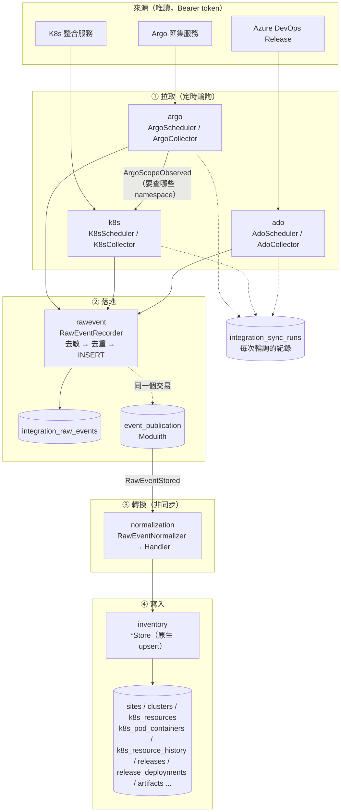
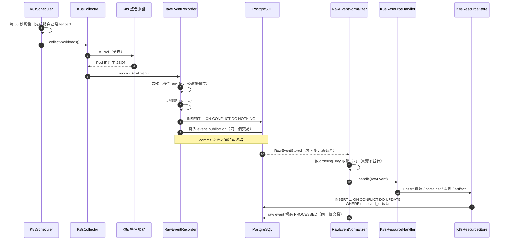
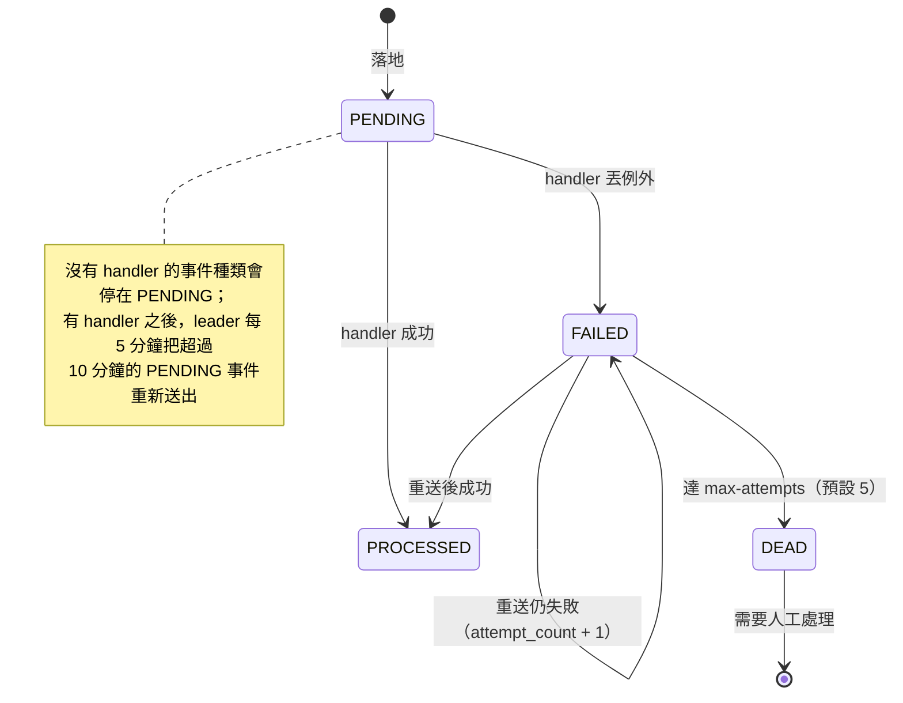
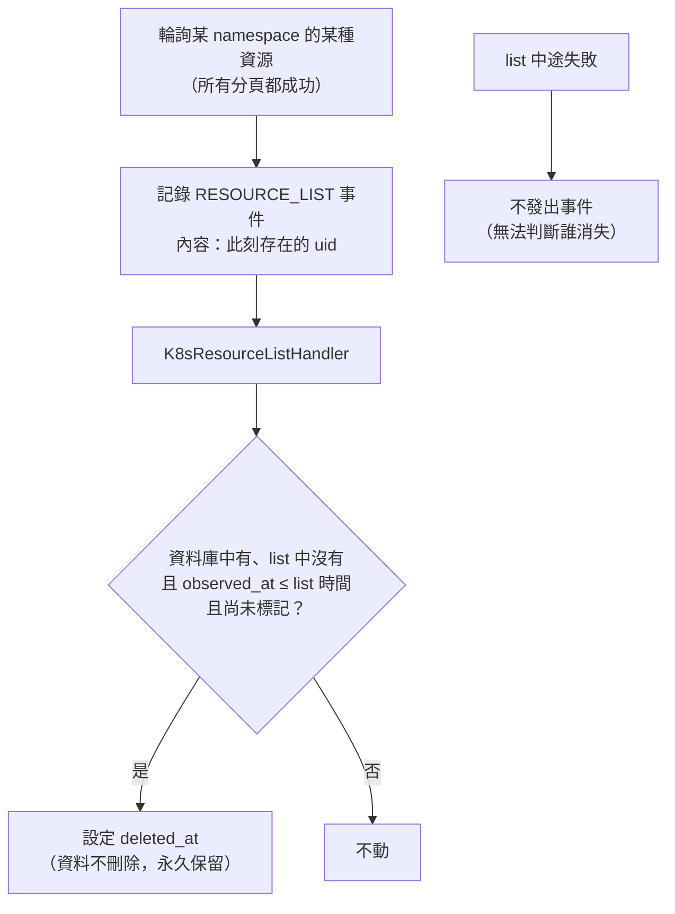

# collector-service

CMDB（AI 維運助理）的資料擷取服務。它**主動往外拉**資料（Azure 連不進公司網路，不用 webhook），原樣落地，再整理成 domain 表，讓 AI 能回答「這個服務上次部署發生什麼」「pod 為何重啟」。

> 狀態：兩個整合服務（Argo 匯集服務、K8s 整合服務）還不存在，整條流程目前只在測試中用假資料與真的 PostgreSQL 驗證過，沒有對真實系統跑過。

## 一句話看懂

這是一條 **ETL 管線**：

```
拉取 (Extract)  →  落地 (Stage)  →  轉換 (Transform)  →  寫入 (Load)
argo / k8s         rawevent          normalization          inventory
```

## 整體架構



重點：

- **argo 與 k8s 互不呼叫**，只透過一個事件 `ArgoScopeObserved` 溝通：Argo 說「我管這些叢集和 namespace」，K8s 只去查這個範圍。
- **落地與轉換是分開的**。先把原始資料存起來，轉換失敗時可以重跑，不必再打來源。
- **雙寫靠同一個交易**：raw event 和「通知轉換」的事件在同一個交易內寫入（transactional outbox），不會只寫一半。

## 一筆資料的完整旅程

以「K8s 輪詢到一個 Pod」為例：



幾個容易被忽略的細節：

- **內容沒變就不會產生新事件**。事件 ID 由「資源 uid + resourceVersion」（K8s）或「內容指紋」（Argo）組成，重複輪詢撞到唯一鍵就被略過。
- **舊資料不會蓋掉新資料**。upsert 的條件是 `observed_at` 不早於已存的值。
- **同一個資源的事件依序處理**（`KeyedLocks`），不同資源可以並行。

## 失敗與重試



- 失敗時，錯誤與次數記在 raw event（`FAILED`、`attempt_count`、`last_error`），例外往外丟，所以 Modulith 的 publication 保持「未完成」。
- **leader** 每 60 秒呼叫 `NormalizationScheduler`，把未完成的 publication 重送一次（程序重啟、暫時性錯誤之後也靠它）。
- 達 5 次標為 `DEAD`，不再重試；DEAD 事件已寫入的部分資料會保留。

## 刪除怎麼偵測

輪詢（list）**看不到「消失」的資源**，所以多一個步驟：



資料**永久保留**：來源消失後，資料列仍在，只是 `deleted_at` 有值。

### 狀態歷史

`k8s_resource_history` 記錄資源的關鍵狀態（Pod 的 phase、重啟次數、映像 digest；Deployment / ReplicaSet 的副本數與映像）。只有這些欄位變化才新增一列，每列有 `valid_from` / `valid_to`（目前的那列 `valid_to` 為空），所以能查「某個時間點的狀態」。資源被標記刪除時，目前那列同時關閉。

## 程式碼怎麼找

```
io.cmdb.collector
├── argo/           ① 拉取：Argo 匯集服務（ArgoCollector、ArgoScheduler、HttpArgoHub）
├── ado/            ① 拉取：Azure DevOps（簡稱 ADO）Release（AdoCollector、AdoScheduler、HttpAdoHub）
├── k8s/            ① 拉取：K8s 整合服務（K8sCollector、K8sScheduler、HttpK8sHub、ManagedNamespaces）
├── rawevent/       ② 落地：RawEvent、RawEventRecorder、PayloadRedactor、ContentFingerprint
├── trigger/        手動觸發收集的 API（POST /collect，Bearer token）
├── normalization/  ③ 轉換：RawEventNormalizer、各種 *Handler、KeyedLocks、NormalizationScheduler
├── inventory/      ④ 寫入：*Store（port）、Jpa*Store、SpringData*Repository、*Entity
├── syncrun/        每次輪詢的紀錄（資料新鮮度）與 7 天清理
├── leader/         K8s Lease 的 leader election（只有 leader 才輪詢與重送）
├── security/       預設的 SecurityFilterChain、collector 自己的 JWT 金鑰、POST /auth/token 簽發與驗證
└── http/           呼叫兩個整合服務用的 RestClient
```

每個 context 內部再分 `domain`（介面與資料型別）/ `application`（流程）/ `infrastructure`（HTTP、資料庫、排程）。依賴方向由 ArchUnit 與 Spring Modulith 在測試中檢查。

### 完整資料夾結構

```
cmdb/                                   上層目錄（設計文件與工具）
├── PLAN.md  ARCHITECTURE.md  DATA_DICTIONARY.md  INTEGRATION_API_SPEC.md  SOURCE_MAPPING.md
├── VERIFICATION_CHECKLIST.md / .xlsx   驗證清單
├── CMDB簡報講稿.md  整合服務 API 需求.html
├── tools/
│   └── export_collector_public.py
└── collector-service/                  本服務（pom.xml 在這裡）
    ├── pom.xml
    ├── README.md  CLAUDE.md  JWT_DEPLOYMENT.md
    └── src/
        ├── main/
        │   ├── java/io/cmdb/collector/
        │   │   ├── CollectorApplication.java
        │   │   ├── <context>/                 每個 context 的根套件有 package-info.java（@BoundedContext）
        │   │   │   ├── domain/                介面與資料型別
        │   │   │   ├── application/           流程
        │   │   │   └── infrastructure/        HTTP、資料庫、排程
        │   │   │   （argo、ado、k8s、rawevent、syncrun、normalization、trigger、security 的根目錄另有 CLAUDE.md）
        │   │   ├── inventory/
        │   │   │   ├── domain/                依資料種類再分：argo、artifact、cluster、deployment、k8s、release、site
        │   │   │   └── infrastructure/        Jpa*Store、SpringData*Repository、*Entity
        │   │   ├── leader/                    只有 domain、infrastructure
        │   │   ├── security/                  domain、application、infrastructure
        │   │   └── http/                      HubRestClients（RestClient 工廠，沒有分層）
        │   └── resources/
        │       ├── application.yml
        │       ├── openapi/                   contract first 的 API 契約：auth.yaml、trigger.yaml
        │       └── db/migration/              Flyway：V1__init.sql（全部 DDL，不入版控，需另外取得）
        └── test/
            ├── java/io/cmdb/collector/
            │   ├── <context>/…                與 main 的 package 一對一：XTest（單元）、XIT（碰資料庫）
            │   └── support/                   DatabaseTest、PostgresIntegrationTest、PipelineTest、SharedPostgres、
            │                                  Fakes、Fixtures、TestPayloads、TestKeys
            └── resources/fixtures/            WireMock 回應內容，依整合服務分：ado、argo、k8s
```

### 想了解某件事，從這裡開始讀

| 想知道 | 讀這個 |
|---|---|
| 多久拉一次、拉什麼 | `k8s/infrastructure/K8sScheduler`、`argo/infrastructure/ArgoScheduler`、`application.yml` 的 `collector.*` |
| 落地前做了什麼 | `rawevent/application/RawEventRecorder` |
| 為什麼不會重複 / 不會漏 | `RawEventRecorder`（去重與 outbox）、`SpringDataJpaRawEventRepository`（`ON CONFLICT`） |
| 一種事件怎麼變成 domain 表 | `normalization/application/RawEventNormalizer` → 對應的 `*Handler` |
| 為什麼舊資料不會蓋掉新資料 | `inventory/infrastructure/SpringDataK8sResourceRepository`（`WHERE observed_at <= ...`） |
| 失敗怎麼重試 | `RawEventNormalizer`、`RawEventLifecycle`、`NormalizationScheduler` |
| 多個副本怎麼避免重複拉取 | `leader/infrastructure/LeaseLeaderGate` |
| 端對端（WireMock 假 hub → DB） | `src/test/.../CollectorEndToEndIT` |
| 寫入規則（較新才覆蓋、刪除標記） | `src/test/.../inventory/infrastructure/Jpa*StoreIT`（`@DataJpaTest` slice） |
| 一種事件怎麼對應到寫入（單元測試） | `src/test/.../normalization/application/*HandlerTest`（假 Store：`RecordingStores`） |
| 重試與 DEAD 的接線（整合） | `src/test/.../normalization/application/RawEventNormalizerIT` |

## 排程一覽

| 工作 | 頻率 | 說明 |
|---|---|---|
| Argo Application 輪詢 | 30 秒 | Argo 只保留最近一次 operationState |
| Argo resource-tree | 5 分鐘 | Application 有變化時另會立即取；內容沒變時每小時仍重新落地一次 |
| 重新送出 PENDING 的事件 | 5 分鐘 | leader 才執行；只送「現在有 handler」且超過 10 分鐘的 |
| Argo 叢集清單 | 1 小時 | 啟動後 60 秒才開始，讓 K8s 叢集先建立 |
| K8s Deployment / ReplicaSet / Pod | 60 秒 | 只查 Argo 涵蓋的 namespace |
| K8s Warning Event | 30 秒 | 叢集內 Event 只留約 1 小時 |
| K8s 叢集 / 廠區清單 | 1 小時 | |
| ADO（Azure DevOps）release 部署 | 60 秒 | 增量（水位），直接呼叫 ADO REST；未設定 `ADO_ORGANIZATION` / `ADO_PROJECTS` 時不輪詢 |
| 重送未完成的事件 | 60 秒 | leader 才執行 |
| 清除 7 天前的 sync_runs | 每天 03:17 UTC | 小批次刪除 |

以上都可以用「手動觸發收集」API 立刻執行一次。

## 手動觸發收集

不想等排程時，可以要求 collector 立刻去來源拉一次（API 的契約是 `src/main/resources/openapi/trigger.yaml`，server interface 與回應類別由 OpenAPI Generator 產生，說明見 `src/main/java/io/cmdb/collector/trigger/CLAUDE.md`）。需先設定 `COLLECTOR_JWT_ENABLED=true`、collector 自己的 JWT 金鑰與 `COLLECTOR_ADMIN_TOKEN`，沒設的話這些端點一律回 404；只應在叢集內部使用。驗證由 Spring Security 負責：先用 admin token 呼叫 `POST /auth/token`（填 subject、roles）取得 JWT，再帶著它呼叫 `/collect`，金鑰、設定與流程見 `src/main/java/io/cmdb/collector/security/CLAUDE.md`，部署步驟（產生金鑰、K8s Secret、驗證、更換金鑰、疑難排解）見 `JWT_DEPLOYMENT.md`。

```bash
curl -X POST -H "Content-Type: application/json" -H "Authorization: Bearer $COLLECTOR_ADMIN_TOKEN" -d '{"subject":"ops","roles":["COLLECT"]}' http://collector:8080/auth/token   # 取得 JWT（回應的 token 欄位）
curl -X POST -H "Authorization: Bearer $JWT" http://collector:8080/collect/argo/applications   # 單一 job
curl -X POST -H "Authorization: Bearer $JWT" http://collector:8080/collect/k8s                  # 一個來源的全部 job
curl -X POST -H "Authorization: Bearer $JWT" http://collector:8080/collect                       # argo → k8s → ado
curl -H "Authorization: Bearer $JWT" http://collector:8080/collect                               # 列出有哪些 job
```

請求會等收集結束才回應，回應裡每個 job 有 `status`、`runs`（0 代表沒有東西可收）、`durationMs`、`errors`（沒成功的原因，格式 `provider: 原因`）；每次 sync 的細節在 `integration_sync_runs`。

## 建置與測試

```bash
export JAVA_HOME=/opt/homebrew/opt/openjdk@21/libexec/openjdk.jdk/Contents/Home   # 預設 java 是 17
cd collector-service   # pom.xml 在這個目錄，不需要上層的 pom
mvn spotless:apply
mvn test     # 單元 + ArchUnit/Modulith + PostgreSQL Testcontainers 的整合測試（需要 Docker），全部一起跑
mvn verify   # 同上，再加 spotless 格式檢查與打包
mvn test -Dtest='*Test'   # 只跑不需要 Docker 的單元測試
```

**資料庫 schema**：由這個服務的 Flyway 在啟動時自動建立與升級（`src/main/resources/db/migration`，`V1__init.sql` 是全部 DDL），不需要事先手動執行 SQL。**這個 repo 不含 `V1__init.sql`（schema 不入版控）**，需另外取得並放到 `src/main/resources/db/migration/`，否則應用程式與整合測試（`mvn test`、`mvn verify` 中的 `*IT`）無法建立 schema。連線帳號第一次啟動需要有建表權限；若想讓執行用的帳號只有讀寫權限，另設 `SPRING_FLYWAY_USER`、`SPRING_FLYWAY_PASSWORD`（只用於 migration 的帳號）。已有表但沒有 `flyway_schema_history` 的非空資料庫會被拒絕（刻意不自動 baseline）。第一次部署前 V1 可以修改；部署後每個變更都要新增 `V2__…sql`，不要改已套用的檔案。

整合測試用 Testcontainers 的空 PostgreSQL，schema 由 Flyway 的 `db/migration` 建立（和正式環境同一份），容器整個 JVM 共用一個。ByteBuddy plugin 綁在 `process-classes`，只跑 `mvn compile` 不會轉換 entity。

## 目前還沒做

- Argo：`deployments` 只依 API spec 做了 Argo 端的欄位（operationState 的 phase、時間、revision、initiatedBy、info）；還沒做：對到 release（`release_deployment_id`、`trigger_type=PIPELINE`）、`build_id`、`application_revision`、`status.history` 的補回、依 K8s 的結果判定 SUCCEEDED／FAILED、`runtime_target_id`（要人工登記）、stream。
- ADO 的核准（`release_approvals`）與 CI builds（所以 `releases.ci_build_id` 目前為空）、`deployments`（Argo／叢集端對應，部署的定義已定為 ADO CD 部署，即 `release_deployments`）、watch / stream。
- `cmdb-contract`、`cmdb-service`。
- Lease leader election 與兩個整合服務都沒有對真實環境測過；多實例行為未驗證。
- 非同步執行緒池的佇列沒有上限。
- collector 的資料庫帳號需要 domain 表與 `event_publication` 的寫入權限，要和 DBA 確認。

更多設計背景見上層目錄的 `PLAN.md`、`ARCHITECTURE.md`、`V1__init.sql`（DDL，不入版控，需另外取得）、`INTEGRATION_API_SPEC.md`，以及各 context 內的 `CLAUDE.md`。
